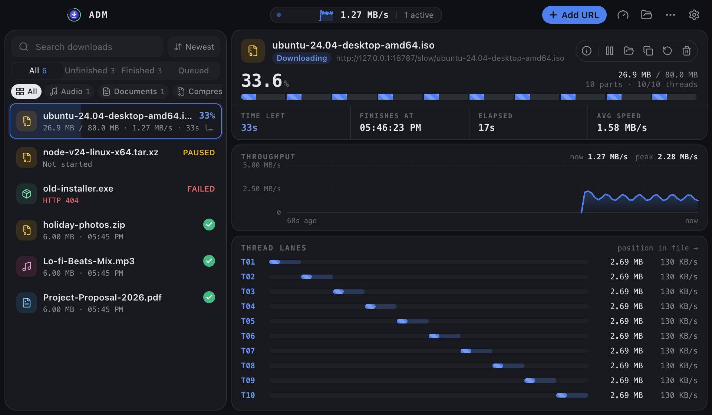
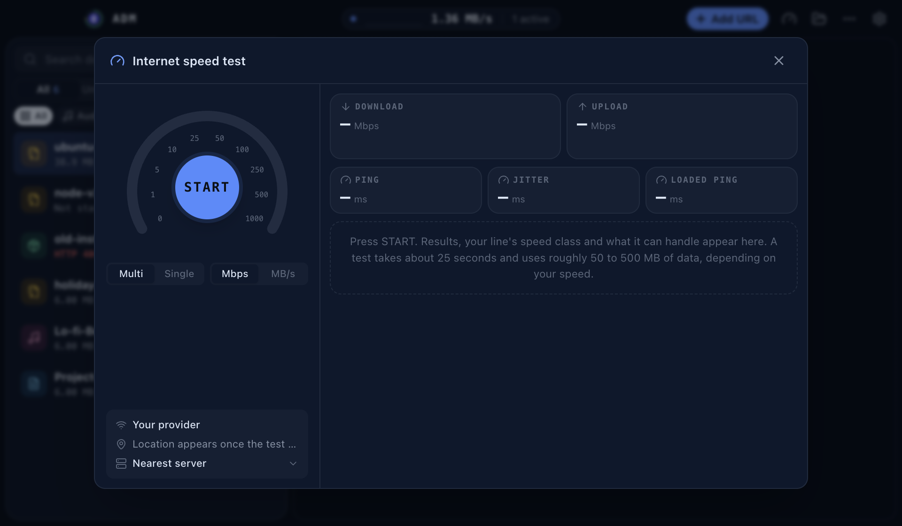
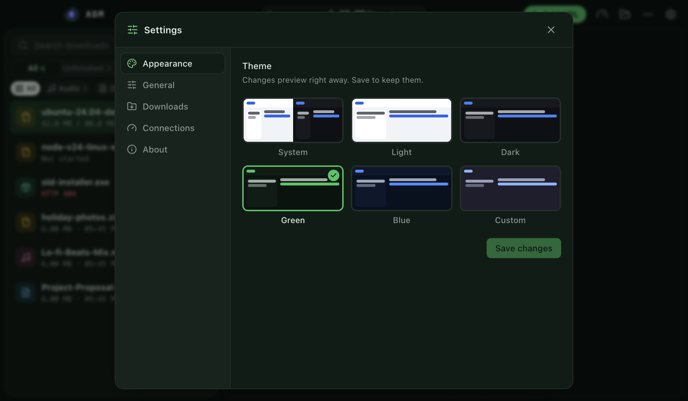
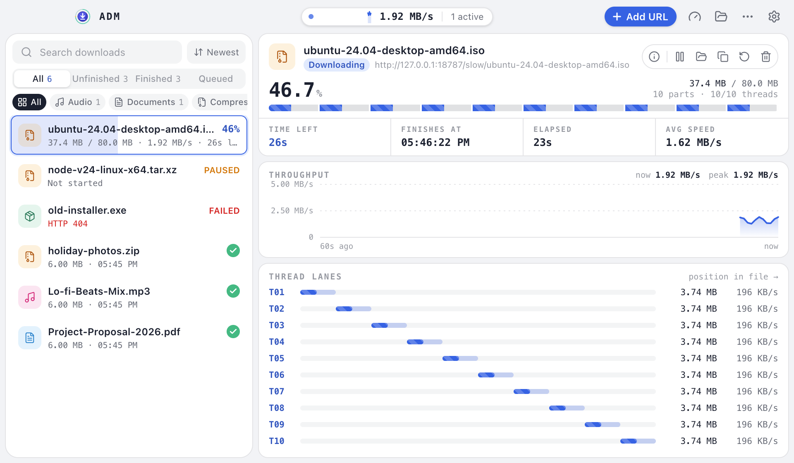

<p align="center">
  
</p>

<p align="center">
  Official downloads for apps by <b>Amito</b>. This repository holds installers only; the source code is private.<br/>
  Every installer is built automatically by GitHub Actions and published here as a GitHub Release.
</p>

<br/>

## Apps

<table>
  <tr>
    <td width="96" align="center"></td>
    <td>
      <b><a href="#adm-amito-download-manager">ADM, Amito Download Manager</a></b><br/>
      Fast, multi-threaded downloads with live thread lanes and a built-in speed test.<br/>
      <sub>Version 1.0.0 &nbsp;·&nbsp; macOS, Windows, Linux &nbsp;·&nbsp; Free</sub>
    </td>
  </tr>
</table>

<br/>

---

<a id="adm-amito-download-manager"></a>

<p align="center">
  
</p>

<h2 align="center">ADM, Amito Download Manager</h2>

<p align="center">
  <b>Download faster. See every thread.</b><br/>
  ADM splits every file across up to 32 threads, shows exactly what each one is doing,<br/>
  and tells you to the second when it will finish. Plus a built-in internet speed test.
</p>

<p align="center">
  
  
  
  
</p>

<p align="center">
  <a href="https://github.com/amiamitswe/amito-releases/releases/download/adm-v1.0.0/ADM-1.0.0-mac-arm64.dmg"></a>
  <a href="https://github.com/amiamitswe/amito-releases/releases/download/adm-v1.0.0/ADM-1.0.0-win-x64.exe"></a>
  <a href="https://github.com/amiamitswe/amito-releases/releases/download/adm-v1.0.0/ADM-1.0.0-linux-x86_64.AppImage"></a>
</p>

<p align="center"><sub>Intel Mac, Windows ARM, .deb and other files are listed under <a href="#all-adm-downloads">All downloads</a>.</sub></p>

<br/>

<p align="center">
  <picture>
    <source media="(prefers-color-scheme: dark)" srcset="assets/adm/main-dark.png" />
    <source media="(prefers-color-scheme: light)" srcset="assets/adm/main-light.png" />
    
  </picture>
</p>

### Highlights

<table>
  <tr>
    <td width="50%" valign="top">
      ⚡ <b>Up to 32 threads per file</b><br/>
      <sub>Every file is split into parts that download at the same time.</sub>
    </td>
    <td width="50%" valign="top">
      🧵 <b>Live thread lanes</b><br/>
      <sub>See what each thread is doing, with a real-time speed chart.</sub>
    </td>
  </tr>
  <tr>
    <td valign="top">
      ⏯️ <b>Pause and resume, even after restarts</b><br/>
      <sub>Progress is saved per thread, with automatic retries.</sub>
    </td>
    <td valign="top">
      📋 <b>Grab links instantly</b><br/>
      <sub>Copy a link and ADM offers to download it. Add many at once.</sub>
    </td>
  </tr>
  <tr>
    <td valign="top">
      🗂️ <b>Tidy folders</b><br/>
      <sub>Files are sorted into category folders automatically.</sub>
    </td>
    <td valign="top">
      🛡️ <b>Safe by default</b><br/>
      <sub>Checksum verification, no overwrites, disk-space checks.</sub>
    </td>
  </tr>
  <tr>
    <td valign="top">
      📶 <b>Internet speed test</b><br/>
      <sub>Download, upload, ping and jitter, with your choice of server.</sub>
    </td>
    <td valign="top">
      🎨 <b>Six themes plus your own colours</b><br/>
      <sub>Light, dark and more, with a global speed limit too.</sub>
    </td>
  </tr>
</table>

### Screenshots

<table>
  <tr>
    <td width="50%" align="center">
      <br/>
      <sub>Built-in internet speed test</sub>
    </td>
    <td width="50%" align="center">
      <br/>
      <sub>Six themes, including your own colours</sub>
    </td>
  </tr>
  <tr>
    <td align="center">
      <br/>
      <sub>Light theme</sub>
    </td>
    <td align="center">
      <br/>
      <sub>Dark theme</sub>
    </td>
  </tr>
</table>

<a id="all-adm-downloads"></a>

### All downloads

<details open>
<summary><b>🍎 macOS</b> &nbsp;<sub>macOS 12 Monterey or later</sub></summary>
<br/>

| Mac | Installer | Archive |
|---|---|---|
| Apple Silicon (M1 and later) | [ADM-1.0.0-mac-arm64.dmg](https://github.com/amiamitswe/amito-releases/releases/download/adm-v1.0.0/ADM-1.0.0-mac-arm64.dmg)<br/> | [.zip](https://github.com/amiamitswe/amito-releases/releases/download/adm-v1.0.0/ADM-1.0.0-mac-arm64.zip)<br/> |
| Intel | [ADM-1.0.0-mac-x64.dmg](https://github.com/amiamitswe/amito-releases/releases/download/adm-v1.0.0/ADM-1.0.0-mac-x64.dmg)<br/> | [.zip](https://github.com/amiamitswe/amito-releases/releases/download/adm-v1.0.0/ADM-1.0.0-mac-x64.zip)<br/> |

<sub>Not sure which Mac you have? Apple menu → About This Mac. "Chip: Apple M…" means Apple Silicon.</sub>

</details>

<details open>
<summary><b>🪟 Windows</b> &nbsp;<sub>Windows 10 or 11</sub></summary>
<br/>

| PC | Installer | Portable |
|---|---|---|
| x64 (most PCs) | [ADM-1.0.0-win-x64.exe](https://github.com/amiamitswe/amito-releases/releases/download/adm-v1.0.0/ADM-1.0.0-win-x64.exe)<br/> | [.zip](https://github.com/amiamitswe/amito-releases/releases/download/adm-v1.0.0/ADM-1.0.0-win-x64.zip)<br/> |
| ARM64 (Snapdragon) | [ADM-1.0.0-win-arm64.exe](https://github.com/amiamitswe/amito-releases/releases/download/adm-v1.0.0/ADM-1.0.0-win-arm64.exe)<br/> | [.zip](https://github.com/amiamitswe/amito-releases/releases/download/adm-v1.0.0/ADM-1.0.0-win-arm64.zip)<br/> |
| Not sure | [ADM-1.0.0-win.exe](https://github.com/amiamitswe/amito-releases/releases/download/adm-v1.0.0/ADM-1.0.0-win.exe)<br/> (both, larger download) | |

</details>

<details open>
<summary><b>🐧 Linux</b> &nbsp;<sub>Ubuntu 20.04, Debian 11, Fedora 36 or newer</sub></summary>
<br/>

| CPU | AppImage (any distro) | .deb (Debian, Ubuntu) | Archive |
|---|---|---|---|
| x64 | [ADM-1.0.0-linux-x86_64.AppImage](https://github.com/amiamitswe/amito-releases/releases/download/adm-v1.0.0/ADM-1.0.0-linux-x86_64.AppImage)<br/> | [ADM-1.0.0-linux-amd64.deb](https://github.com/amiamitswe/amito-releases/releases/download/adm-v1.0.0/ADM-1.0.0-linux-amd64.deb)<br/> | [.tar.gz](https://github.com/amiamitswe/amito-releases/releases/download/adm-v1.0.0/ADM-1.0.0-linux-x64.tar.gz)<br/> |
| ARM64 | [ADM-1.0.0-linux-arm64.AppImage](https://github.com/amiamitswe/amito-releases/releases/download/adm-v1.0.0/ADM-1.0.0-linux-arm64.AppImage)<br/> | [ADM-1.0.0-linux-arm64.deb](https://github.com/amiamitswe/amito-releases/releases/download/adm-v1.0.0/ADM-1.0.0-linux-arm64.deb)<br/> | [.tar.gz](https://github.com/amiamitswe/amito-releases/releases/download/adm-v1.0.0/ADM-1.0.0-linux-arm64.tar.gz)<br/> |

</details>

<sub>Older versions: <a href="https://github.com/amiamitswe/amito-releases/releases?q=adm-v">all ADM releases</a></sub>

<a id="adm-download-stats"></a>

### Download stats

<!-- adm-stats:start -->
| ADM 1.0.0 | Downloads |
|---|---:|
| 🍎 macOS | 4 |
| 🪟 Windows | 3 |
| 🐧 Linux | 4 |
| **Total** | **11** |

<sub>Updated daily from GitHub's download counts · counting since 2026-11-11 · last change 2026-11-14 09:51 UTC</sub>
<!-- adm-stats:end -->

### Installing

> [!NOTE]
> The current builds are not code-signed yet, so your system may warn you the first time you open ADM. This is expected.

<details>
<summary><b>macOS</b></summary>
<br/>

1. Open the `.dmg` and drag **ADM** into **Applications**.
2. The first time, right-click ADM and choose **Open**, then click **Open** again.

</details>

<details>
<summary><b>Windows</b></summary>
<br/>

1. Run the `.exe` installer.
2. If SmartScreen appears, click **More info**, then **Run anyway**.

</details>

<details>
<summary><b>Linux</b></summary>
<br/>

**AppImage:** make it executable, then run it.

```bash
chmod +x ADM-1.0.0-linux-x86_64.AppImage
./ADM-1.0.0-linux-x86_64.AppImage
```

**.deb:**

```bash
sudo apt install ./ADM-1.0.0-linux-amd64.deb
```

</details>

### Verify your download

Each file's SHA-256 checksum is shown next to it on the [release page](https://github.com/amiamitswe/amito-releases/releases?q=adm-v). To check a file you downloaded:

| System | Command |
|---|---|
| macOS / Linux | `shasum -a 256 <file>` |
| Windows (PowerShell) | `Get-FileHash <file>` |

### Report a problem

Found a bug or have an idea? [Open an issue](https://github.com/amiamitswe/amito-releases/issues/new) and start the title with **[ADM]**. Please include your operating system, the ADM version and the steps to reproduce it.

---

<p align="center">
  <sub>© 2026 Amit Samadder. All rights reserved.</sub>
</p>
